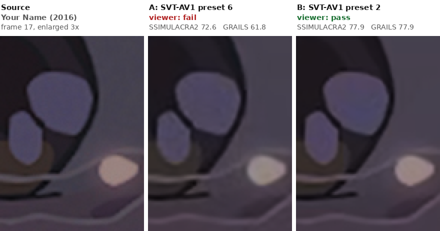

# GRAILS examples

Scenes from the blind tests GRAILS was calibrated on. Each image shows the same frame and spot of every version,
enlarged without smoothing so the grain stays visible. Unless a section says otherwise, the scores are this tool's
(full mode, GRAILS model 0.2.1) for exactly the frames and window the viewer judged, a 3.3-second clip, and "viewer"
is the verdict the viewer gave each encode, blind, against the source. For each metric, a green ✓ marks its score
for the encode it rightly prefers (the one the viewer passed), and a red ✗ its score for the encode it wrongly
prefers. `tools/make_examples.py` regenerates the images and the numbers (`docs/images/examples.json`). Back to the
[README](../README.md).

- [Film grain: The Lighthouse (2019)](#film-grain-the-lighthouse-2019)
- [Heavy grain: Black Swan (2010)](#heavy-grain-black-swan-2010)
- [Film grain: The Hunt (2012)](#film-grain-the-hunt-2012)
- [Line art: Your Name (2016)](#line-art-your-name-2016)
- [AV1 grain seeds in standard players: Black Swan (2010)](#av1-grain-seeds-in-standard-players-black-swan-2010)
- [Clean footage: 1917 (2019)](#clean-footage-1917-2019)

## Film grain: The Lighthouse (2019)

Look at the skin of the forehead and cheeks. Both encodes are AV1 with the same settings and CRF. Encode A, a plain
encode, smoothed the grain away. Encode B removed the grain before encoding and lets the player re-create it with AV1
film-grain synthesis. The viewer failed A and passed B, which is also a quarter smaller. Plain SSIMULACRA2 prefers A,
because a smooth picture is closer to the source pixel for pixel than new random grain; GRAILS agrees with the viewer.
(This scene is one of those GRAILS was fitted on.)

| The Lighthouse (2019) | viewer | SSIMULACRA2 | GRAILS | bitrate |
|---|---|---|---|---|
| A: AV1, no grain synthesis (grain smoothed away) | fail | 81.2 | 58.0 | 1.21 Mb/s |
| B: denoised, AV1 film-grain synthesis | pass | 75.7 | 93.3 | 0.90 Mb/s |

## Heavy grain: Black Swan (2010)

Look at the skin of the face. Both encodes are AV1 at CRF 33 with film-grain synthesis. A puts the grain back at
half the strength fitted to the source (and starts from a differently denoised picture); B uses the full fitted
strength. The viewer failed A and passed B, which is also 28 % smaller. On grain this heavy, plain SSIMULACRA2 says
almost nothing: it gives the passing encode 0.1, near the bottom of its scale, and prefers A, whose weaker grain
differs less from the source pixel for pixel. GRAILS scores B 87.6 and A 58.7. Across all five encodes the viewer
judged in this scene, GRAILS puts both passes above all three fails, while SSIMULACRA2 gives its highest score to a
fail. (This scene is one of those GRAILS was fitted on.)

| Black Swan (2010) | viewer | SSIMULACRA2 | GRAILS | bitrate |
|---|---|---|---|---|
| A: AV1, synthetic grain at half strength | fail | 10.2 | 58.7 | 2.47 Mb/s |
| B: AV1, synthetic grain at full strength | pass | 0.1 | 87.6 | 1.78 Mb/s |

## Film grain: The Hunt (2012)

The same comparison as The Lighthouse, on another film. Look at the cheek and the forehead: A's skin is smooth and
waxy, B's has the source's texture. Both encodes are AV1 at the same settings and CRF; B is 14 % smaller. The viewer
failed A, noting missing grain and skin texture on a face in another shot of the clip, and passed B. Plain
SSIMULACRA2 again prefers A, by about 4 points; GRAILS puts B 31 points ahead. (This scene is one of those GRAILS
was fitted on.)

| The Hunt (2012) | viewer | SSIMULACRA2 | GRAILS | bitrate |
|---|---|---|---|---|
| A: AV1, no grain synthesis (grain smoothed away) | fail | 82.4 | 61.0 | 0.65 Mb/s |
| B: denoised, AV1 film-grain synthesis | pass | 78.6 | 91.6 | 0.56 Mb/s |

## Line art: Your Name (2016)

4K HDR, tone-mapped for this picture. Both encodes are SVT-AV1 4.2.0 at the same file size: A at preset 6, B at the
much slower preset 2. Look at the tear highlight and the line under it: in A they are surrounded by a faint halo and
look smeared; B keeps them clean. The viewer failed A and passed B. SSIMULACRA2 ranks them the same way (both
metrics get a ✓), but its 72.6 for A doesn't tell you anything is wrong: on the other films, encodes with an
SSIMULACRA2 of 72 to 74 passed about half the time in the blind tests (15 of 29 showings). GRAILS's line-art check
measures the halos next to the lines and takes 10.9 points off A; B has none, so its GRAILS is its SSIMULACRA2. The
crop is from the frames where GRAILS measured A's strongest ringing. (This scene was not among those GRAILS was
fitted on.)

| Your Name (2016) | viewer | SSIMULACRA2 | GRAILS | bitrate |
|---|---|---|---|---|
| A: SVT-AV1 4.2.0, preset 6 | fail | 72.6 | 61.8 | 1.51 Mb/s |
| B: SVT-AV1 4.2.0, preset 2 | pass | 77.9 | 77.9 | 1.51 Mb/s |

## AV1 grain seeds in standard players: Black Swan (2010)

An AV1 encode with film-grain synthesis carries no grain, only a description of it and a random seed for each frame;
the player makes the grain. Standard players (dav1d, ffmpeg, hardware decoders) do it as the AV1 standard prescribes:
they make one small grain patch per frame from the seed and tile it across the picture. The tiling itself is fine. The
trouble is unlucky seeds: with some seeds the patch has clumps or holes, and tiling repeats them all over the frame,
where the eye catches them at once.

All three panels are one encode of a 10-second scene with very heavy grain (frame 58, enlarged 2x). A and B differ only
in their seeds, rewritten in the stream without re-encoding: A has the worst-rated seed for each frame, B the
best-rated. The bottom row shows the grain alone, with the contrast raised 6x: A's grain has dark holes in a regular
grid, B's is even. The third panel is A again, with its grain drawn over the whole frame by
[av1-fullgrain](https://github.com/divergentnn/av1-fullgrain): there is no patch, so nothing repeats, whatever the
seed.

In a blind test of these versions as a standard player shows them, the viewer ranked the best-rated seeds first and the
worst-rated last, with an earlier seed pick second and the encoder's own seeds third.

GRAILS scores the grain the encode describes, drawn over the whole frame, so the seeds don't change the score. Its
separate **standard-decoder seed view** rates each frame's seed for the clumps and holes of its grain patch (and flags
seeds that make striped patches), from 0 (best) to 100 (worst). It is uncalibrated and never part of the score; on the
blind seed tests, it put 14 of 15 judged pairs of versions in the viewer's order.

| Black Swan (2010), whole scene, 240 frames | SSIMULACRA2 | GRAILS | seed view (mean) | frames with a seed in the worst tenth |
|---|---|---|---|---|
| A: worst-rated seeds | 0.9 | 98.7 | 77 | 32 % |
| the encoder's own seeds | 0.9 | 98.7 | 51 | 12 % |
| B: best-rated seeds | 1.0 | 98.6 | 27 | 0 % |

Plain SSIMULACRA2 gives all three about 1: against grain this heavy, new random grain never matches the source's
pixel for pixel. The scores here are for the whole scene against its source; the blind test was an ordering, not
pass or fail.

## Clean footage: 1917 (2019)

With no grain and no line art in the source, GRAILS is plain SSIMULACRA2, to the last digit. Four encodes of a
daylight close-up (4K HDR; the source has a little noise, below GRAIL's grain threshold), judged blind:

| 1917 (2019) | viewer | SSIMULACRA2 | GRAILS | bitrate |
|---|---|---|---|---|
| x264, CRF 13 | pass | 79.67 | 79.67 | 23.5 Mb/s |
| x265, CRF 17 | fail | 73.05 | 73.05 | 12.0 Mb/s |
| SVT-AV1, CRF 10 | fail | 72.94 | 72.94 | 15.7 Mb/s |
| SVT-AV1, CRF 17 | fail | 63.95 | 63.95 | 8.2 Mb/s |
